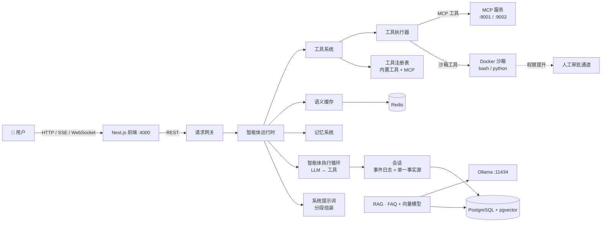

<div align="center">

# 🤖 minidsh

**支持受控工具执行、会话持久化与人工审批的minidsh。**

通过统一的执行循环、并发工具调度、会话恢复与权限审批运行智能体。
结合可视化工作流和 FAQ 检索增强生成（RAG），构建客服与知识助手等应用。


</div>

---

## ✨ 功能特性

- 🎨 **可视化工作流**：在 React Flow 画布上拖放并连接智能体，一键保存和运行完整流程。
- 🤖 **多智能体运行时**：所有智能体均由用户配置创建；通用运行时支持工具调用，
  路由类型支持三级级联意图路由，不预置业务 Agent。
- 🧩 **分段系统提示词**：每轮对话按已注册的内容组装提示词，涵盖身份、角色、各工具的使用指导
  与运行时上下文；配置修改立即生效，工具说明与工具实现保持一致。
- 📚 **RAG 知识库**：结合 `pg_trgm`、Ollama 向量模型（`bge-m3`）、`pgvector`、
  CrossEncoder 重排模型和大语言模型（LLM）润色，实现 FAQ 管理与检索。
- ⚡ **语义缓存**：基于 Redis 的缓存中间件，配合策略引擎管理缓存有效期（TTL）、置信度评分
  和可缓存意图，让重复问题得到快速响应。
- 🧠 **长期记忆**：支持按用户管理会话上下文、摘要、压缩与经验记忆，持续积累可复用的信息。
- 🔧 **工具系统**：分为注册表、运行时和执行器三层，统一接入内置工具与 MCP 工具；
  并发调度器支持滚动任务池、独占屏障和有序提交，各工具可声明超时、执行模式与使用指导。
- 🔒 **沙箱执行**：`bash` / `python` 工具在临时 Docker 容器中运行，支持只读（`read-only`）、
  工作区可写（`workspace-write`）与完全访问（`danger-full-access`）三种文件权限模式；
  超出当前模式的操作需经过**人工审批**，无法确认权限时默认拒绝执行。
- 🔌 **MCP 支持**：内置模型上下文协议（MCP）服务与注册表，可在控制台导入和管理外部 MCP 服务。
- 📖 **技能与斜杠命令**：在工作区输入 `/` 选择技能或命令，支持参数展开、模型按需加载、
  运行中调用与会话恢复；通过 `/skill-installer` 按技能名称或公开 GitHub 地址在聊天中安装完整技能包，
  详见[技能与命令说明](docs/skills-commands.md)。
- 🗂️ **会话工作区**：每个会话拥有独立工作目录，可在控制台浏览、预览 PDF、图片与文本，
  并上传文件；工作区与沙箱使用同一路径。
- 🧾 **事件日志会话**：会话事件日志是单一事实源，对话历史、执行轨迹与冷恢复均由它派生。
- 💬 **实时对话**：支持控制台 SSE 流式响应与 WebSocket 对话。
- 🏢 **多租户**：基于 `X-Tenant-ID` 实现隔离，支持 SaaS 场景。

## 🧱 技术栈

| 层级 | 技术 |
| ---- | ---- |
| 前端 | Next.js 14 · React 18 · TypeScript · React Flow（`@xyflow/react`）· TanStack Query |
| 后端 | FastAPI · Python 3.12 · uvicorn · 基于 `psycopg2` 的原生 SQL |
| 数据库 | PostgreSQL 16 + `pgvector`（向量检索）+ `pg_trgm`（模糊匹配）|
| 缓存 | Redis 7（redis-stack）|
| 大语言模型 | 各智能体独立配置，支持任意 OpenAI 兼容网关（`/v1/chat/completions`）|
| 向量与重排模型 | Ollama `bge-m3` + `BAAI/bge-reranker-v2-m3`（CrossEncoder）|
| 沙箱 | 临时 Docker 容器，通过挂载的 `docker.sock` 访问 Docker 服务 |
| 协议 | 模型上下文协议（MCP）· SSE · WebSocket |
| 基础设施 | Docker Compose |

## 🚀 快速开始

支持本地、混合和 Docker 三种部署。Python 3.12+、Node.js 20+ 环境下：

```sh
python minidsh.py setup              # 安装 .venv、插件和前端依赖，创建 .env.local
python minidsh.py dev --mode hybrid  # 前后端本地运行，Docker 只启动数据库和 Redis
# 已有 PostgreSQL：python minidsh.py dev
# 本地生产：python minidsh.py build && python minidsh.py start
```

配置 `.env.local` 后也可执行 `python minidsh.py doctor` 检查环境。
原有 `docker compose up -d --build` 保留。完整说明见[部署方式](docs/deployment.md)。

> FAQ 语义检索需要运行中的 [Ollama](https://ollama.com/) 实例，并安装 `bge-m3` 向量模型
> （`ollama pull bge-m3`）。开始模型对话前，请在控制台配置智能体的模型地址与 API 密钥。

```bash
# 1. 启动全部服务（数据库、Redis、后端和前端）
docker compose up -d --build

# 2. 打开控制台
open http://localhost:4000
```

插件默认零配置：`tools-default` 会自动装配。要额外加载插件，把 `plugins.yaml.example` 复制为仓库根目录的 `plugins.yaml`，重启 backend 即可；不写这个文件也能正常启动。

重排模型会在首次 RAG 请求时下载，并持久化到 `hf_cache` 数据卷。
如需在构建时预下载，请在项目根目录的 `.env` 文件中设置 `PRELOAD_RERANKER=true`，
然后重新构建后端。后端会等待数据库与 Redis 健康检查通过后启动。

| 服务 | 地址 |
| ---- | ---- |
| 前端控制台 | http://localhost:4000 |
| 后端 API | http://localhost:8000 |
| RedisInsight | http://localhost:5540  |

MCP 服务（`:9001` 为通用服务，`:9002` 为论文服务）仅监听后端容器内网，不映射到宿主机。
在宿主机上调试可执行：`docker compose exec backend curl localhost:9001/mcp`。

沙箱需要后端容器能够访问宿主机的 Docker 守护进程（已挂载 `/var/run/docker.sock`），
并配置独立的工作区根目录，详见下方「配置说明」。

## 🏗️ 系统架构



**执行链路的单一事实源**：一次对话产生的所有事件，包括用户消息、助手消息、工具调用与结果、
运行限制和用量统计，都写入 `Session` 的事件日志。对话历史、执行轨迹与冷恢复均由它派生。
详见
[`backend/agents/runtime/session/session.md`](backend/agents/runtime/session/session.md)。

**系统提示词的组装**：系统提示词在每轮请求时由 `SystemPrompt` 根据已注册的身份、角色、
各工具的使用指导与运行时上下文动态生成，渲染后作为 `messages[0]` 注入，不写入事件日志。
配置修改可立即生效，工具的 JSON 结构定义（通过 `tools` 参数传入）与自然语言使用指导
（通过提示词传入）来自同一来源，保持一致。详见
[`backend/agents/runtime/system_prompt/system-prompt.md`](backend/agents/runtime/system_prompt/system-prompt.md)。

## 📁 项目结构

```
minidsh/
├── backend/
│   ├── agents/            # 智能体实现与运行时
│   │   ├── runtime/       #   AgentRuntime · AgentLoop
│   │   │   ├── session/   #   事件日志 · 对话视图 · 持久化 · 各类投影（见模块内 session.md）
│   │   │   └── system_prompt/  # 分段注册的提示词组装（见模块内 system-prompt.md）
│   │   ├── router/        #   三级级联意图路由（关键词 → 向量 → LLM 函数调用）
│   ├── api/               # REST 与 WebSocket 接口
│   │   └── workspace.py   #   会话工作区：文件浏览 / 预览 / 上传 / 预创建会话
│   ├── core/              # 基础设施：数据库连接与表结构、JWT 认证、RAG 向量与重排模型
│   ├── engine/            # 工作流引擎：LangGraph 构建器、处理器、状态与中间件
│   ├── interaction/       # 通用人工审批层（沙箱升权等能力的裁决通道）
│   ├── gateway/           # 请求入口：RequestContext 与通道分发
│   ├── services/          # 业务服务：FAQ、对话、记忆与缓存
│   └── integrations/      # 第三方渠道集成（闲鱼）
├── packages/              # 插件 SDK/runtime、tools-default、mcp-client/manager、tool-host、sandbox、工具与技能包
├── docs/                  # 设计文档（sandbox-design.md 等）
├── frontend/
│   └── app/
│       ├── dashboard/     # 智能体、对话、知识库、MCP、记忆与工作流
│       │   └── workspace/ # 工作区浏览器与工作区内对话
│       └── agents/        # 各智能体的配置页面
└── docker-compose.yml     # 数据库、Redis、后端与前端服务编排
```

## 📡 API 概览

| 方法 | 接口路径 | 说明 |
| ---- | -------- | ---- |
| POST | `/api/auth/login` | JWT 登录 |
| GET | `/api/agents` | 获取智能体列表 |
| POST | `/api/agents` | 创建智能体，配置存储在数据库中 |
| GET | `/api/agents/{key}/config` | 读取合并后的智能体配置 |
| PUT | `/api/agents/{key}/config` | 更新智能体配置 |
| GET | `/api/agents/{key}/prompt-preview` | 查看组装后的系统提示词与可用工具 |
| POST | `/api/agents/{key}/chat` | 与智能体对话 |
| POST | `/api/agents/{key}/chat/stream` | 通过 SSE 进行流式对话 |
| POST | `/api/agents/{key}/route-test` | 测试意图路由 |
| GET | `/api/workflows` | 获取工作流列表 |
| POST | `/api/workflows` | 创建工作流 |
| POST | `/api/workflows/{id}/run` | 运行工作流 |
| GET | `/api/faqs` · POST `/api/faqs` | 知识库增删改查 |
| GET | `/api/conversations` | 获取会话与消息 |
| GET | `/api/mcp/servers` · POST `…/import` | 管理 MCP 服务 |
| GET | `/api/tools/bindings` · PUT `…/{agent_key}` | 为智能体绑定工具 |
| GET | `/api/workspace/sessions` · POST `/api/workspace/sessions` | 获取或预创建工作区会话 |
| GET | `/api/workspace/folders` · POST `/api/workspace/folders` | 浏览宿主机目录或在目录中创建空条目 |
| GET | `/api/workspace/{id}/files` · `/file` | 浏览与预览工作区文件 |
| POST | `/api/workspace/{id}/files` · `/upload` | 创建空文件或文件夹、上传文件 |
| PATCH | `/api/workspace/{id}/title` | 重命名会话，记录 `session/title` 事件并固定标题 |
| GET | `/api/memory/users` | 获取用户长期记忆档案 |
| GET | `/api/approvals` · POST `…/{id}` | 获取待审批请求或提交审批决定 |
| WS | `/api/ws/chat` | 实时对话 |

完整交互式接口文档：`http://localhost:8000/docs`（Swagger UI）。

## ⚙️ 配置说明

环境变量（详见 `docker-compose.yml`）：

| 变量 | 默认值 | 说明 |
| ---- | ------ | ---- |
| `DATABASE_URL` | `postgresql://saas:saas@db:5432/saas` | PostgreSQL 连接地址 |
| `JWT_SECRET` | `dev-secret` | 令牌签名密钥 |
| `OLLAMA_HOST` | `http://host.docker.internal:11434` | 向量与重排服务地址 |
| `NEXT_PUBLIC_API_URL` | `http://localhost:8000` | 前端访问后端的基础地址 |
| `SANDBOX_WORKSPACE_ROOT` | `/srv/agent/workspaces` | 沙箱工作区根目录，需对宿主机可见 |
| `SANDBOX_DEFAULT_MODE` | `workspace-write` | 文件权限模式：只读（`read-only`）、工作区可写（`workspace-write`）、完全访问（`danger-full-access`）|
| `SANDBOX_READ_ROOTS` | — | 额外的宿主机**只读**挂载目录，以逗号分隔；`C:/,D:/` 表示可读取对应盘符下的全部内容 |
| `SANDBOX_WRITE_ROOTS` | — | 额外的宿主机**可写**挂载目录，以逗号分隔 |

**各智能体独立配置模型**：每个智能体通过 `base_url` / `api_key` / `model` 配置模型，
支持任意 OpenAI 兼容网关，如 DeepSeek、OpenAI、vLLM。可在控制台的智能体配置页填写，
或通过 `PUT /api/agents/{key}/config` 更新。

### 📄 论文 MCP：模型配置

论文 MCP（`packages/tools/paper-mcp/`，端口 `:9002`）提供 `search_papers` /
`fetch_paper_text` / `summarize_paper` / `list_papers` 四个工具。总结论文时会在
**工具内部**调用大语言模型，因此需要配置 OpenAI 兼容网关（`/v1/chat/completions`）。

配置方式（二选一，JSON 文件优先）：

**方式一：JSON 配置文件（推荐）**

```bash
# 复制配置模板（模板纳入版本管理，真实配置已被 .gitignore 忽略）
cp packages/tools/paper-mcp/src/agent_platform_paper_mcp/llm.config.example.json \
   packages/tools/paper-mcp/src/agent_platform_paper_mcp/llm.config.json
```

编辑 `llm.config.json` 中的以下三项。代码目录以绑定挂载方式接入容器，修改后即时生效，无需重启：

```json
{
  "base_url": "https://api.openai.com/v1",
  "api_key": "sk-...",
  "model": "gpt-4o"
}
```

**方式二：环境变量**（通过 Docker Compose 注入）

```bash
# 项目根目录 .env
PAPER_LLM_BASE_URL=https://api.openai.com/v1
PAPER_LLM_API_KEY=sk-...
PAPER_LLM_MODEL=gpt-4o
# 应用配置
docker compose up -d backend
```

**用户创建的论文研究智能体**还需单独配置编排模型，由 `AgentRuntime` 使用，
与论文总结层相互独立，可使用不同模型。通过 `PUT /api/agents/{your_agent_key}/config`，
或在控制台的智能体配置页填写 `base_url` / `api_key` / `model`。
建议 `max_steps: 8`、`max_tokens: 3000`（默认已内置）。

### 🍃 Overleaf MCP

后端自动注册 `overleaf` 工具服务，提供 LaTeX 文件读写、编译、PDF 下载与版面查询。
`overleaf-mcp-plus[compile]==0.3.1` 使用独立 Python 环境，不影响平台的 MCP SDK 版本。
账户凭据在项目根目录 `.env` 中配置：`OVERLEAF_GIT_TOKEN` 用于 Git 文件操作，
`OVERLEAF_SESSION` 用于项目列表、编译与下载。安装和使用见 [Overleaf MCP 文档](docs/overleaf-mcp.md)。

## 🗺️ 开发路线

- [x] 可视化工作流构建与运行
- [x] 多智能体运行时（FAQ、意图路由、监督编排与人工接管）
- [x] RAG 知识库与语义缓存
- [x] 长期记忆系统
- [x] 支持 MCP、沙箱执行与人工审批的工具系统
- [x] 分段系统提示词组装
- [x] 会话工作区（文件管理、预览与上传）
- [ ] 工作流草稿的版本管理与回滚
- [ ] MCP 服务插件市场
- [ ] 数据分析控制台（对话轮次、缓存命中率、人工接管率）
- [ ] 将记忆系统接入主智能体运行时

## 🤝 参与贡献

欢迎参与贡献！提交合并请求前，请先创建议题讨论改动，也可以从开发路线中选择任务。

1. 派生仓库并创建开发分支（`git checkout -b feat/amazing`）。
2. 提交改动（`git commit -m 'feat: 添加新功能'`）。
3. 推送分支并发起合并请求。

### 开发说明

插件公共协议位于独立包 [`packages/plugin-sdk`](packages/plugin-sdk/README.md)，YAML 加载、entry point 发现、依赖排序和生命周期管理位于 [`packages/plugin-runtime`](packages/plugin-runtime/README.md)；默认工具实现仍由后续包提供。

后端启动时总是装配单轨工具运行时：插件侧的 `tools-default` 持有唯一 `tools.v1` 注册表；MCP 工具实现位于 [`packages/tools/`](packages/tools/README.md)，由 `agent-platform.mcp-client` 插件连接并注册（`agent-platform.mcp-manager` 负责运行时导入/探测/重连）；沙箱 `bash`/`python` 由 [`packages/plugins/sandbox-tools`](packages/plugins/sandbox-tools/README.md) 注册，技能 `skill`/`skill_install` 由 [`packages/plugins/skill-tools`](packages/plugins/skill-tools/README.md) 注册。AgentLoop、系统提示词和工具列表都只读这一个注册表，并只经它执行。`PLUGIN_CONFIG` 只决定额外加载哪些插件，不再决定是否启用工具服务；四个默认工具插件（tools-default、mcp-manager、skill-tools、sandbox-tools）会自动补上。Docker 镜像已内置 SDK、runtime、tools-default 和示例插件，例如：

默认零配置启动，不需要设置任何插件变量：

```bash
docker compose up -d
```

`mcp_servers` 表里的 MCP server 会自动转换成 `agent-platform.mcp-client` 插件实例，不需要在 YAML 里手写；设置 `PLUGIN_MCP_AUTO=false` 可关闭自动装配。

要额外加载插件时，把 `plugins.yaml.example` 复制成仓库根目录的 `plugins.yaml`（Docker 内是 `/app/plugins.yaml`），重启 backend 即可；`PLUGIN_CONFIG` 只用于把配置放到其他路径。本地开发一次安装插件栈：

```bash
pip install -r requirements-plugins.txt
```

- 后端改动后若 `--reload` 卡住，可执行 `docker compose restart backend`。
- 测试与模块位于同一目录（`test_*.py`），自带 `main()` 运行器，容器内未安装 pytest：

  ```bash
  docker compose exec backend python backend/agents/runtime/system_prompt/test_system_prompt.py
  docker compose exec backend python backend/tests/test_sandbox.py
  ```

## 📄 许可证

[MIT](LICENSE) © 2026

---

<div align="center">
⭐ 如果这个项目对你有帮助，欢迎点亮一颗星！
</div>
